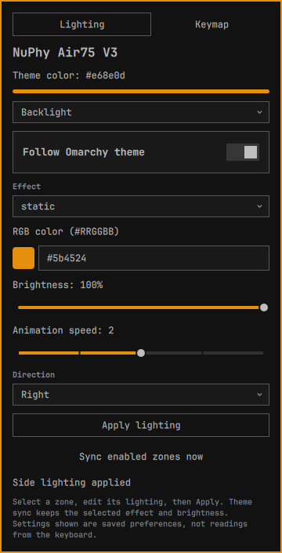

# NuPhy for Omarchy

A native Quickshell bar plugin for lighting control, Omarchy theme sync, and
keymap editing on NuPhy keyboards supported by
[`nuphyctl`](https://github.com/fldc/nuphyctl).



- Independent backlight and side-light controls with per-zone Omarchy theme sync.
- Visual Air75 V3 keymap editor and a matrix view for other layouts.
- Auto Sleep, sleep timers, and opt-in swappable knob/button settings.
- Shared editing drafts across monitors, explicit Apply, and keymap recovery backups.

## Install

Requires Omarchy’s Quickshell-based shell, Python 3, and `nuphyctl` on PATH.
Keyboard settings require **nuphyctl 0.7.0 or newer**.

```bash
omarchy pkg aur add nuphyctl-bin
omarchy plugin add https://github.com/fldc/omarchy-nuphy.git --enable
```

Installing the plugin does not install the CLI or grant HID device access.
After installing the CLI package, reconnect the keyboard while logged into your
local desktop session. Run the plugin and CLI as your normal user.
See the [installation guide](docs/installation.md) for permissions, upgrades,
and removal.

## Use

Click the keyboard icon in the bar to open **Lighting**, **Keymap**, or **Settings**.
Edit your preferences and use the tab’s **Apply** button to write changes.
Theme sync starts disabled; enable **Follow Omarchy theme** for each zone you
want to sync.

Open the popup from a keybinding or terminal with `omarchy-shell nuphy toggle`.
See the [usage guide](docs/usage.md) for lighting, keymap editing, and keyboard
settings.

## Documentation

- [Installation, permissions, upgrades, and removal](docs/installation.md)
- [Lighting, keymaps, and keyboard settings](docs/usage.md)
- [Local development and testing](docs/development.md)
- [Settings integration validation](docs/settings-validation.md)
- [0.3.0 validation and remaining manual checks](docs/validation-0.3.0.md)
- [Roadmap](ROADMAP.md)

## License

[MIT](LICENSE). The screenshots and marketplace preview are included under the
same license.
