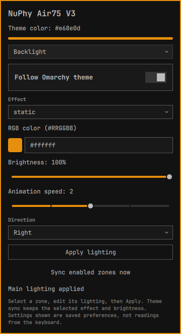

# NuPhy for Omarchy

A native Quickshell bar plugin for NuPhy keyboards supported by `nuphyctl`.
The title follows the connected keyboard’s reported product name; when the CLI
cannot identify an automatic target, it falls back to “NuPhy keyboard”.



- Independent backlight and side-light controls.
- All 20 main effects and all five side-light effects exposed by nuphyctl.
- Custom `#RRGGBB`, brightness, animation speed and main-light direction.
- Per-zone automatic sync with `~/.local/state/omarchy/current/theme/keyboard.rgb`.
- Theme sync preserves each zone’s chosen effect, brightness and speed.
- Verified NuPhy targets with explicit HID interface selectors on every write.
- One persistent service shared by all monitors, with serialized HID writes.
- Event-driven theme and hotplug detection, with a 60-second discovery fallback.
- 12-second HID command timeout, 30-second failure retry cooldown.
- Device-specific sync cache, invalidated on reconnect and worker restart.
- Lazy popup creation, per-zone editing drafts, and keyboard-adjustable sliders.
- Atomic preferences with safe recovery and backups of damaged state.
- Persistent preferences; no keymap access, network access or elevated privileges.

## Install

Requires Omarchy’s Quickshell-based shell, Python 3 and
[`nuphyctl`](https://github.com/fldc/nuphyctl) on PATH.
The keyboard’s control interface must be accessible to your user.

Install `nuphyctl` from the AUR using the
[`nuphyctl-bin`](https://aur.archlinux.org/packages/nuphyctl-bin) package:

```bash
omarchy pkg aur add nuphyctl-bin
```

Install and enable the plugin directly from GitHub:

```bash
omarchy plugin add https://github.com/fldc/omarchy-nuphy.git --enable
```

This installs the plugin and adds its keyboard icon to the bar. If you install
without `--enable`, enable it later with:

```bash
omarchy plugin enable local.nuphy
```

### Local development install

To load a local checkout instead of installing from GitHub:

```bash
ln -s "$PWD" ~/.config/omarchy/plugins/local.nuphy
omarchy plugin validate ~/.config/omarchy/plugins/local.nuphy
omarchy plugin enable local.nuphy
```

Run the symlink command from this project directory. Do not overwrite an existing
plugin with the same ID. Layout changes hot-reload; if plugin code stays cached,
run `omarchy restart shell`. The 0.2.0 update adds a service entry point and needs
one shell restart when upgrading from 0.1.0.

## Disable or remove

Disable the plugin without uninstalling it:

```bash
omarchy plugin disable local.nuphy
```

Remove an installed plugin:

```bash
omarchy plugin remove local.nuphy
```

Disabling or removing stops the plugin's automatic sync; it does not restore
previous keyboard colors. Saved preferences in
`~/.local/state/omarchy-nuphy/` are retained. The plugin does not install udev
rules, modify keymaps, or overwrite other application settings.

## Use

Click the keyboard icon, select a lighting zone, edit its preferences and click
**Apply lighting**. To sync a zone, check **Follow Omarchy theme** and Apply.
Click the color square to open an inline color picker. Choose a hue, then use
the color field to adjust saturation and value. Picking a color switches the
selected zone to manual mode; no HID command is sent until you click Apply.
You can also enter a `#RRGGBB` value directly. Escape closes the picker first.

Sync is initially disabled for every zone: installing the widget never changes
the keyboard on its own. Linux inotify watches the theme file, its symlink
ancestors, and HID device-node changes. Events are coalesced for 200 milliseconds;
theme changes do not spawn helper processes unless enabled lighting needs a write.
One slow fallback enumerates devices every 60 seconds, regardless of monitor count.

**Sync enabled zones now** forces a reapply, useful after reconnecting or changing
lighting with the keyboard itself. Preferences are not live hardware readings;
`nuphyctl` currently provides lighting writes but no lighting-state readback.
Pending edits survive zone switches while the popup component is loaded.
Apply saves a zone’s preferences
even if the device is disconnected; enabled sync retries after 30 seconds.
Manual (non-sync) writes can be retried with Apply.

State lives in `$XDG_STATE_HOME/omarchy-nuphy/state.json` (normally
`~/.local/state/omarchy-nuphy/state.json`). All bar instances use the same service;
a singleton worker lock prevents competing writers. State lock acquisition times
out after two seconds. Discovery happens outside the state lock.

Damaged preferences are retained as `state.corrupt-<timestamp>.json` before safe
defaults are restored with sync disabled. A restart/reconnect reapplies enabled
zones once: cached success does not imply the hardware retained its settings.
Multiple equally ranked NuPhy keyboards are deliberately treated as ambiguous;
no lighting commands are sent until one unambiguous target is available.

Open from a keybinding or terminal:

```bash
omarchy-shell nuphy toggle
```

## Development

```bash
python3 -m unittest discover -s tests -v
omarchy plugin validate .
```

Tests include mocked hardware, actual worker-process protocol/event tests with a
fake CLI, and an offscreen Quickshell editor smoke test. They never send HID
commands to your keyboard. The UI test requires installed Omarchy shell components
and Quickshell; it skips when these are unavailable. Sliders support Tab focus
and Left/Right arrow adjustment. Mouse-wheel and touchpad scrolling over sliders
scrolls the popup instead of changing lighting values.

English translations are in `i18n/en.json`;
other Omarchy languages fall back to English.

## License

[MIT](LICENSE). The screenshot and marketplace preview are included under the
same license.
