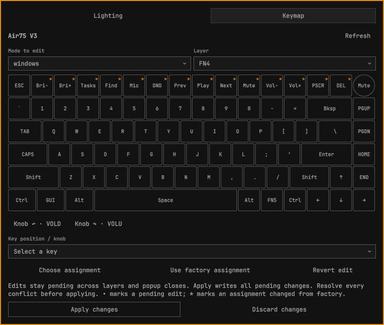

# Using NuPhy for Omarchy

[← README](../README.md)

The popup title follows the connected keyboard’s reported product name; when the
CLI cannot identify an automatic target, it falls back to “NuPhy keyboard”.

## Lighting

Click the keyboard icon, open **Lighting**, select a lighting zone, edit its
preferences and click **Apply lighting**. To sync a zone, check **Follow Omarchy
theme** and Apply.
Click the color square to open an inline color picker. Choose a hue, then use
the color field to adjust saturation and value. Picking a color switches the
selected zone to manual mode; no HID command is sent until you click Apply.
You can also enter a `#RRGGBB` value directly. Escape closes the picker first.
With theme sync off, disable **Use custom color** to use the effect’s default
palette colors, then Apply. Your custom color is kept for when you enable it
again. This choice is saved separately for each zone.

Sync is initially disabled for every zone: installing the widget never changes
the keyboard on its own. Linux inotify watches the theme file, its symlink
ancestors, and HID device-node changes. Events are coalesced for 200 milliseconds.
Bounded helper reads refresh configuration on events; CLI lighting commands run
when enabled lighting needs a write.
One slow fallback enumerates devices every 60 seconds, regardless of monitor count.

**Sync enabled zones now** forces a reapply, useful after reconnecting or changing
lighting with the keyboard itself. Preferences are not live hardware readings;
`nuphyctl` currently provides lighting writes but no lighting-state readback.
Paste in the color and assignment-search fields runs asynchronously with a
4 KiB transfer limit and a two-second deadline. Ctrl+V, Shift+Insert, the context
menu, and middle-click selection paste use this path. Oversized or stalled
transfers leave the field unchanged; a delayed reply cannot replace newer edits.
Pending edits survive zone switches while the popup component is loaded.
Apply saves a zone’s preferences
even if the device is disconnected; enabled sync retries after 30 seconds.
Manual (non-sync) writes can be retried with Apply.

State lives in `$XDG_STATE_HOME/omarchy-nuphy/state.json` (normally
`~/.local/state/omarchy-nuphy/state.json`). All bar instances use the same service;
a singleton worker lock prevents competing writers. State lock acquisition times
out after two seconds. Discovery happens outside the state lock.

Damaged preferences are retained as `state.corrupt-<timestamp>.json` before safe
defaults are restored with sync disabled. A restart/reconnect reapplies enabled
zones once: cached success does not imply the hardware retained its settings.
Multiple equally ranked NuPhy keyboards are deliberately treated as ambiguous;
no lighting commands are sent until one unambiguous target is available.

Open from a keybinding or terminal:

```bash
omarchy-shell nuphy toggle
```

## Keymap editing



Open **Keymap** to read the keyboard's current and factory mappings. Readings
are cached while the service is running; reopening the popup keeps them. Use
**Refresh** after changing mappings with NuPhyIO or another tool. These readings
come from the keyboard; pending edits are kept separately until Apply.

Choose a mode, layer, and key in the diagram, matrix view, or position selector.
The mode selector chooses which mappings to edit; it does not change the
keyboard’s hardware mode.
Layer labels follow NuPhyIO: FN0–FN3 for Mac and FN4–FN7 for Windows on Air75 V3.
Select **Choose assignment** to search keycodes by name, alias, group, or description.
Momentary layer assignments appear as `MO(n)` in the assignment picker and
`FNn` on the diagram, using absolute layer numbers.
**Use factory assignment** stages the factory value for the selected key;
**Revert edit** removes its pending change.

The Air75 V3 uses a physical ANSI diagram and separate knob rotation buttons.
Other devices show a **Matrix view** using the firmware's rows and columns,
with extra entries listed separately. Its equal-sized cells are a schematic;
firmware coordinates may differ from physical key positions. Large matrices
scroll horizontally to keep cells readable. Zero and transparent assignments
remain selectable. The position selector remains available below the view;
narrow Air75 popups use that selector.

For unsupported layouts, **Request or correct a keyboard layout** opens a
prefilled GitHub issue draft with the model, firmware, matrix dimensions,
extra-entry count and layer count.
Add a top-down photo or NuPhyIO screenshot and layout details before submitting.
Serial numbers, HID paths and keymap contents are excluded. Opening the link
does not submit the issue. You can also
[request a layout directly on GitHub](https://github.com/fldc/omarchy-nuphy/issues/new?template=keyboard-layout.md)
using the [repository issue template](../.github/ISSUE_TEMPLATE/keyboard-layout.md).

Named positions use the CLI’s Windows legends even while editing Mac mode.
Diagram keys show current or pending assignments; hover a key for its physical
position and full assignment. `•` marks an unapplied edit; `*` on the diagram
marks an assignment changed from factory. Unknown keycodes retain their numeric
values.

**Apply changes** writes all pending changes across modes and layers. Opening,
refreshing, selecting keys, and editing never write mappings. Drafts are shared
across monitors and survive popup closes until applied or discarded. A shell
restart clears in-memory drafts. Disconnecting blocks writes until a successful
refresh. Reconnecting an identified keyboard
reconciles the draft; an uncertain identity keeps it detached until you choose
**Review draft for this keyboard**. Incompatible layouts cannot accept that draft.
Generic vendor serial strings (including `NuPhy Keybord 0720`) are not treated as
unique device identification. Keymap errors never automatically retry.

Before applying, the worker reads the keyboard again, saves a binary recovery
backup under `$XDG_STATE_HOME/omarchy-nuphy/keymap-backups/`, and checks edited
keys for external changes. Conflicts stop the entire write. Each conflicting key
shows its current keyboard assignment alongside the original and proposed values.
**Keep keyboard assignment** removes the edit; **Keep my edit** acknowledges the
current value as its new baseline. Both choices only update the draft. Apply rechecks for new conflicts.
Changes to unrelated keys are preserved. Another application can still write
between this check and the CLI operation; the CLI has no conditional-write API.

The CLI also creates its own backup and verifies its writes. The widget reads
back after success or failure, retaining unresolved edits. If readback fails,
refresh is required before retrying. The backup path is shown after an apply
attempt. For manual recovery, use `nuphyctl keymap restore-backup <backup-file>`
with selectors for the intended keyboard; review `--help` and `--dry-run` first.
A complete backup restore can replace unrelated edits made since that backup.

Keymap editing requires CLI support for `info`, `dump`, `keycodes`, and `apply`
with `--json`, plus `dump --defaults` and `dump --raw-out`. An older CLI reports
its command error in the editor; lighting remains available. No automatic profile
restore, whole-mode reset, or macro editor is included.

## Keyboard settings

Open **Settings** to read Auto Sleep and both sleep timers from a mechanical
NuPhy keyboard using the NuPhy IO protocol. **Level 1 Sleep** turns off lights;
**Level 2 Sleep** turns off lights and communication and follows Level 1. Both
ranges are 5–127 minutes. Use the − / + controls to edit; disabling Auto Sleep
preserves the timers. Changes remain pending across popup closes and monitors.
**Apply settings** sends only edited fields and verifies the keyboard's readback.
**Discard changes** restores the displayed readings. **Refresh** rereads hardware
and discards pending settings edits. A disconnect or different device clears
settings drafts; stale readings cannot authorize a write.

Accessory reads are opt-in: choose **Read accessory switch** only for a board
with a swappable knob/button. A successful read enables **Accessory Switch** with
**Knob** and **Button** choices. An unsupported accessory read leaves sleep
controls available. Opening Settings never probes the accessory automatically.

The worker checks device identity and all HID interface selectors, rereads
settings before applying, and stops if edited fields changed externally. After
any write attempt it reads the keyboard again. Failed or mismatched readback
reports an error; writes never retry automatically. A failed read requires
Refresh before another Apply. Another application can still write between
preflight and Apply because the CLI has no conditional-write API.

These controls require **nuphyctl 0.7.0 or newer**, which provides
`settings get/set --json`. Upgrade older installations to `nuphyctl-bin 0.7.0-1`
or newer. The plugin detects the settings commands at runtime and reports the
minimum version when they are unavailable; the CLI does not expose `--version`,
so this is a capability check rather than a numeric version check. HE models use a different configuration block and
are unsupported. There is no Reset Keyboard control. NuPhy IO's Keyboard Layout
selection only changes its web app's virtual key labels; it is not exposed as a
firmware setting.

## Implementation details

- Independent backlight and side-light controls.
- All 20 main effects and all five side-light effects exposed by nuphyctl.
- Custom `#RRGGBB` or default effect colors, brightness, animation speed and main-light direction.
- Per-zone automatic sync with `~/.local/state/omarchy/current/theme/keyboard.rgb`.
- Theme sync preserves each zone’s chosen effect, brightness and speed.
- Verified NuPhy targets with explicit HID interface selectors on every write.
- One persistent service shared by all monitors, with serialized HID writes.
- Event-driven theme and hotplug detection, with a 60-second discovery fallback.
- 12-second lighting command timeout, bounded CLI output and 30-second automatic lighting retry cooldown.
- 30-second timeout per keymap CLI command; keymap writes require an explicit Apply.
- Device-specific sync cache, invalidated on reconnect and worker restart.
- Lazy popup creation, per-zone editing drafts, and keyboard-adjustable sliders.
- Atomic preferences with safe recovery, bounded file reads and backups of damaged state.
- Auto Sleep, two sleep timers and opt-in swappable knob/button settings.
- Visual Air75 V3 keymap editor, searchable assignments, and shared editing drafts.
- Scrollable matrix view for other layouts, with a link to request a physical diagram.
- NuPhyIO layer numbering: FN0–FN3 for Mac and FN4–FN7 for Windows on Air75 V3.
- Explicit keymap Apply with conflict checks, recovery backups, and readback.
- Persistent lighting preferences; no background network access or elevated privileges.
- Optional layout requests open GitHub in your browser for review and submission.
